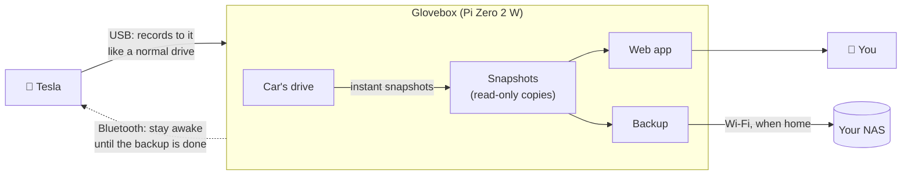

<p align="center">
  
</p>

<h1 align="center">Glovebox</h1>

<p align="center">
  <b>TeslaCam and Sentry Mode backup to your own NAS, from a Raspberry Pi Zero 2 W in your glovebox.</b><br>
  No cloud. No subscription. Nothing leaves your home network.
</p>

<p align="center">
  <a href="https://github.com/lubaxe/glovebox/actions/workflows/go.yml"></a>
  <a href="LICENSE"></a>
  
  
  <a href="https://buymeacoffee.com/lubaxe"></a>
</p>

<p align="center">
  
</p>

Glovebox plugs into your Tesla's USB port and becomes its dashcam drive. Your car records to it as usual. When you park at home, your Sentry Mode events, saved clips and (if you like) all your driving footage copy themselves over Wi-Fi to your NAS: Unraid, Synology, TrueNAS or any SMB share. Browse and play everything from any browser on your network.

<sub>Glovebox is free and open source. If it's useful to you, you can <a href="https://buymeacoffee.com/lubaxe">buy me a coffee</a> ☕</sub>

## Features

- **Automatic backup when you get home.** Glovebox notices your NAS, copies what's new (Sentry first, then saved clips, newest first) and picks up where it left off if the car drives away mid-copy.
- **Keeps the car awake until the backup is done.** A sleeping Tesla cuts USB power. Glovebox pairs with your car over Bluetooth using a *limited* key that can wake it, but can't unlock, open or drive it.
- **Never gets in the car's way.** The car's drive is never touched while the car is using it. Glovebox reads footage from instant copy-on-write snapshots, repairs those instead, and presents the drive to the car about 16 seconds after power-on.
- **Bigger dashcam drive, more history.** The car gets nearly the whole card (52 GB on a 64 GB card), and snapshots keep clips the car has already overwritten.
- **Works with encrypted dashcam recordings.** If your car encrypts its clips, Glovebox backs them up as they are, and downloads a whole drive or event in one go for you to watch on dashcam.tesla.com.
- **Clean web app.** A synchronized six-camera player, Sentry and saved events with thumbnails and locations, your footage grouped into drives, and live status. Works on your phone.
- **Looks after the car's drive.** Clears out events that are safely on your NAS so the car never runs out of room to save new ones. Nothing that isn't backed up is ever deleted.
- **Set up from one file.** Flash the image, fill in Wi-Fi and NAS details in `glovebox.toml` on the card, plug it in.

## Screenshots

<table>
  <tr>
    <td width="50%"><br><sub><b>Player:</b> all six cameras in sync, with scrubbing, speed and downloads.</sub></td>
    <td width="50%"><br><sub><b>Sentry:</b> events with thumbnails, reasons and places. Encrypted ones are marked.</sub></td>
  </tr>
  <tr>
    <td><br><sub><b>Car:</b> pair once with a key card, step by step.</sub></td>
    <td><br><sub><b>Encrypted clips:</b> download a whole drive in one go for dashcam.tesla.com.</sub></td>
  </tr>
  <tr>
    <td colspan="2" align="center"><br><sub><b>On your phone</b>, from the garage.</sub></td>
  </tr>
</table>

<sub>Screenshots use generated sample footage.</sub>

## How it works



1. **The car records** to Glovebox exactly as it would to a USB stick.
2. **Glovebox snapshots the drive** every hour, before each backup, and whenever space runs low. Snapshots are instant and only use space for what the car changes afterwards. Everything Glovebox reads comes from a snapshot, so it never touches files the car might be writing.
3. **At home, it backs up.** When your NAS is reachable, Glovebox copies new clips over SMB, verifying each file before marking it done. If the car drives off, it carries on next time.
4. **The car stays awake** for that first backup after arriving home, at most an hour, so it doesn't cut the power halfway. After that it's free to sleep.

The details, from partitions to power cuts, are in [docs/how-it-works.md](docs/how-it-works.md).

## Lean by design

The Glovebox image is Raspberry Pi OS cut down to what a dashcam drive needs, so it downloads faster, boots faster and leaves more of the card for footage.

| | Glovebox image | Raspberry Pi OS Lite (64-bit) |
|---|---|---|
| Download | **240 MB** | 550 MB |
| Written to the card | **1.3 GB** | 3.1 GB |
| Packages installed | **260** | 633 |
| Card left for footage (64 GB card) | **52 GB** dashcam drive + 4 GB for snapshots | |

<sub>Glovebox v0.1.0 and Raspberry Pi OS Lite are built from the same Raspberry Pi OS release (trixie, 2026-10-06); the Raspberry Pi OS figures are Raspberry Pi's own. 1 MB = 1,000,000 bytes.</sub>

On a Pi Zero 2 W:

| | |
|---|---|
| Power on → car sees its drive | **about 16 s** |
| Fully booted | **15.7 s** (kernel 4.5 s, system 11.2 s) |
| Memory in use | **about 140 MB** of 416 MB |

How: the image is built from Raspberry Pi's own build system, keeping only its base stages and leaving out the desktop, compilers, kernel headers, the Pi 5 kernel, cloud-init, swap, man pages and translations. Glovebox starts before the network, presents the car's drive within about a second, and only then gets on with snapshots and backups. Logs are kept in memory to save writes to the card, with a small copy on the storage partition that survives power cuts.

## What you need

| | |
|---|---|
| **A Raspberry Pi Zero 2 W** | Small enough for the glovebox, and it's the right kind of Pi: it can act as a USB drive. |
| **A microSD card** | A high-endurance card, 64 GB or more; 128–256 GB for more history on HW4 cars. For example SanDisk High Endurance or Samsung PRO Endurance. |
| **A USB cable** | Micro-USB to whatever your car's glovebox port is (USB-C on recent cars). It must carry data, not just power. It goes into the Pi's **USB** port, not **PWR**: one cable powers the Pi and carries the drive. |
| **A NAS or any SMB share** | Reachable from your garage over Wi-Fi. A user and share just for Glovebox is a good idea. |
| **A Tesla** | Tested on a 2026 Model 3 (HW4). Glovebox uses the standard TeslaCam drive, so other models should work too. |
| **A key card** (optional) | To pair keep-awake, once. |

## Getting started

1. **Flash the card.** Download `glovebox-<version>-image.zip` from the [latest release](https://github.com/lubaxe/glovebox/releases/latest) and write it with [Raspberry Pi Imager](https://www.raspberrypi.com/software/) (Choose OS → **Use custom**). Skip Imager's "customise settings": Glovebox doesn't use them.
2. **Fill in `glovebox.toml`.** Open the card's boot partition on your computer and edit `glovebox.toml`: your Wi-Fi, your NAS, and optionally an SSH key. Every setting is explained in the file. Passwords are moved into root-only files at first boot.
3. **Plug it into the car.** At first boot Glovebox sets up Wi-Fi, makes room for the dashcam drive and presents it to the car. It leaves `glovebox-status.txt` on the boot partition saying what it did.
4. **Open the web app** at `http://<the Pi's IP address>:8080` from a device on your home network. Your router's list of devices shows the Pi as `glovebox`; many routers also let you use `http://glovebox:8080` directly.
5. **Pair keep-awake** on the **Car** page: enter your VIN, press *Send pairing request*, lay a key card on the phone charging pad and confirm on the car's screen.

**Already running Raspberry Pi OS Lite (64-bit)?** Install without reflashing:

```sh
curl -fsSL https://github.com/lubaxe/glovebox/releases/latest/download/install.sh | sudo bash
```

The full guide, with troubleshooting, is in [docs/install.md](docs/install.md). Want to try it first? Plug the Pi into a computer instead of the car: the drive shows up as `CAM` and the web app works the same.

## Is it safe?

- **For your car:** the Bluetooth key has Tesla's **Charging Manager** role. We tested it: the car lets it wake up and read the charge level, and refuses unlocking, remote start, flashing the lights and opening the charge port. You can remove it any time under Controls → Locks → Keys.
- **For your footage:** the car's drive is never written to while the car can see it. Glovebox only ever deletes events from the car's drive once they're on your NAS at full size, and only at startup, before the car is connected.
- **For your privacy:** footage goes from the car to your NAS and nowhere else. Glovebox itself never connects to the internet; the Pi only sets its clock from a public time server.
- **On your network:** the web app has no login. Anyone on your home network can view clips and use the Car page, so keep the Pi on a network you trust.

## FAQ

**Does it work with encrypted dashcam recordings?**
Yes. Glovebox backs them up as they are and shows them with a lock. To watch them, open them at [dashcam.tesla.com](https://dashcam.tesla.com) signed in to your Tesla account, or turn off Controls → Safety → Encrypt Dashcam Recordings for clips you can play anywhere.

**How fast is the backup?**
About 2.5–3.5 MB/s over the Pi Zero 2 W's Wi-Fi. Sentry and saved events (a few hundred MB each) take a minute or two. An hour of HW4 driving footage is 15–20 GB, which is why backing up all driving footage is optional (`archive.recent`).

**Will it drain my battery?**
Glovebox keeps the car awake only for the first backup after you arrive home, at most an hour, then lets it sleep for at least six hours. Clips the car records while parked are backed up whenever the car is awake anyway, but never keep it awake.

**What happens when the card fills up?**
The car's drive has a fixed size, and the car manages it like any USB drive. Glovebox clears out backed-up events so the car keeps room for new ones, and drops its oldest snapshots when it needs space.

**Can I use a different Raspberry Pi?**
It needs a Pi that can act as a USB device on its data port. The Zero 2 W is the one Glovebox is built and tested for.

## Configuration

Everything is in `/etc/glovebox/glovebox.toml` on the Pi (from `glovebox.toml` on the boot partition at first boot). Every setting and its default is documented in [deploy/glovebox.toml](deploy/glovebox.toml). To change settings later, put a new `glovebox.toml` on the boot partition and restart the Pi.

## Development

Glovebox is a single Go service (`cmd/glovebox`) on a minimal 64-bit Raspberry Pi OS image.

- `go test ./...` runs anywhere; the hardware parts (loop devices, mounts, the USB gadget, Bluetooth) sit behind small interfaces with fakes.
- `go run ./tools/uidemo` serves the web app with generated sample footage, for working on the UI without a Pi (needs ffmpeg).
- `scripts/deploy.ps1 -Target user@host` cross-compiles for linux/arm64 and installs the service on a Pi over SSH.
- [docs/architecture.md](docs/architecture.md) describes the design, [docs/how-it-works.md](docs/how-it-works.md) the behaviour and the API.

### Building the image

The image is Raspberry Pi OS (Debian 13 "trixie", 64-bit) cut down to what Glovebox needs, with Glovebox and Tesla's `tesla-control` compiled in. See [pi-gen-sources/Readme.md](pi-gen-sources/Readme.md).

- **Releases:** bump `VERSION` and push to the `release` branch. CI builds the image, the programs and `install.sh`, measures the image, and publishes release `v<VERSION>` with checksums.
- **Test builds:** run **Build image** by hand in GitHub Actions for a pre-release.
- **Locally:** run `pi-gen-sources/build-image.sh` on Debian/Ubuntu or WSL2.

## Feedback

Bug reports and ideas are welcome in [Issues](https://github.com/lubaxe/glovebox/issues).

## Credits

Glovebox was inspired by, and started from, [teslausb](https://github.com/marcone/teslausb). Thanks to its authors and contributors. Keep-awake uses Tesla's open-source [vehicle-command](https://github.com/teslamotors/vehicle-command) tools. Their licenses, and those of the libraries Glovebox is built with, are in [THIRD-PARTY-NOTICES.md](THIRD-PARTY-NOTICES.md).

## License

Copyright © 2026 lubaxe.

Glovebox is free software, licensed under the [GNU General Public License v3.0](LICENSE): you can use it, change it and share it, and if you distribute it, changed or not, you must do so under the same license, with its source and this copyright notice. For other licensing, for example to build Glovebox into a commercial product without the GPL's terms, [get in touch](https://github.com/lubaxe/glovebox/issues).

Glovebox is not affiliated with or endorsed by Tesla, Inc. "Tesla" and "TeslaCam" are trademarks of Tesla, Inc., used here only to say what Glovebox works with.
