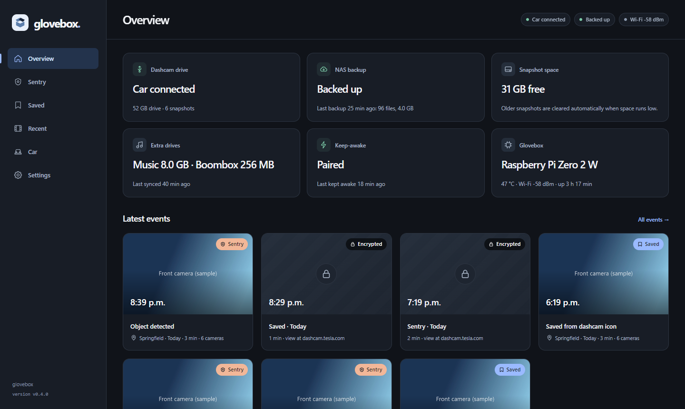
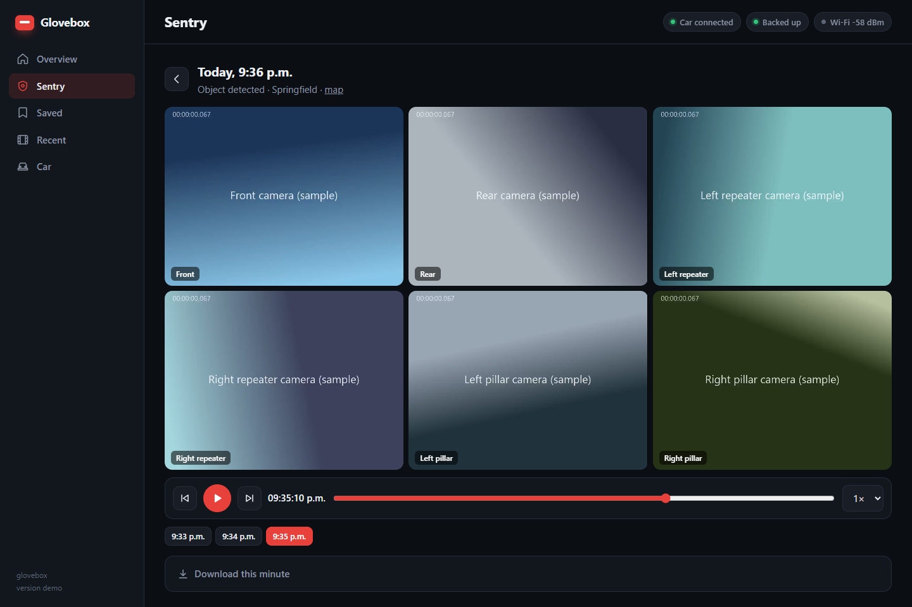
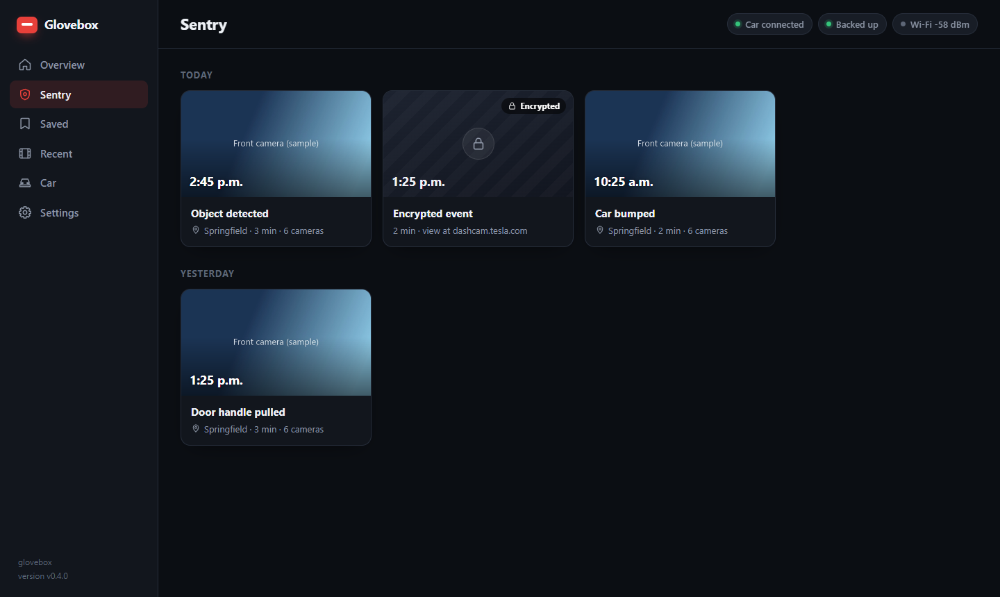
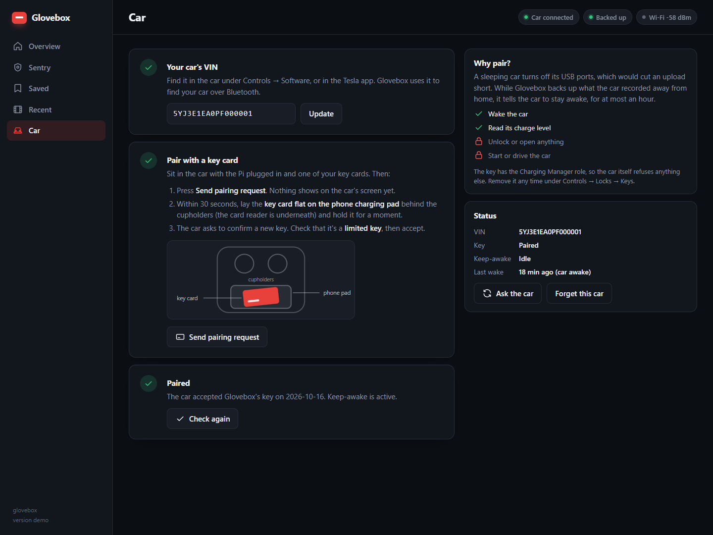
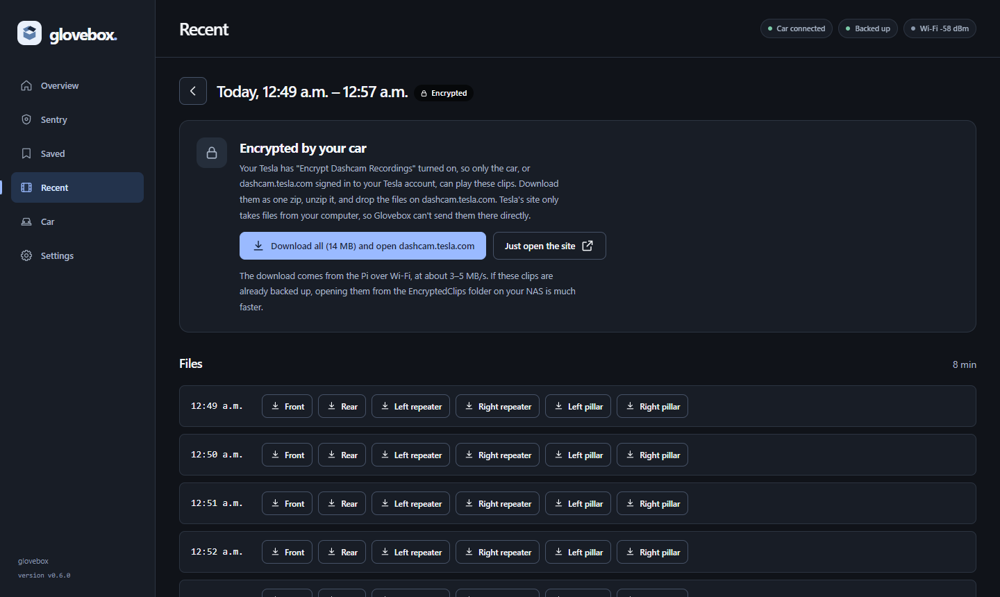
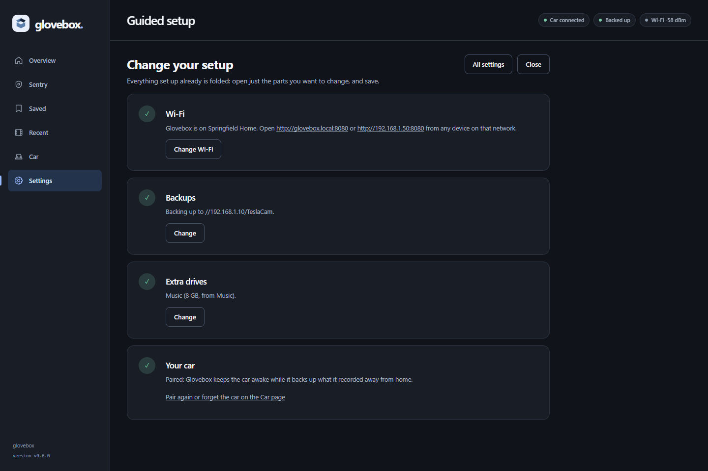
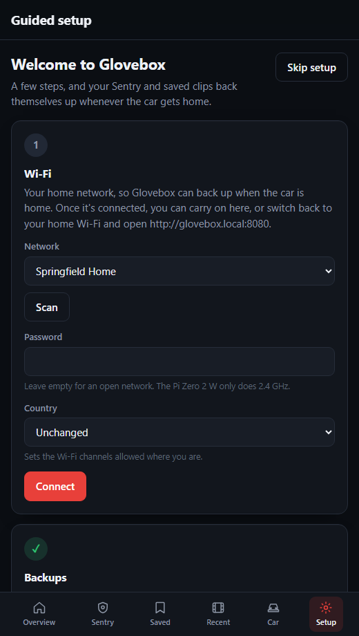
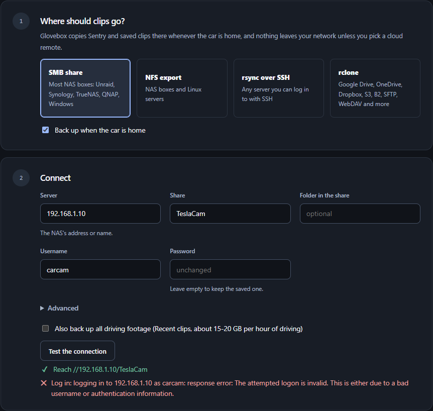
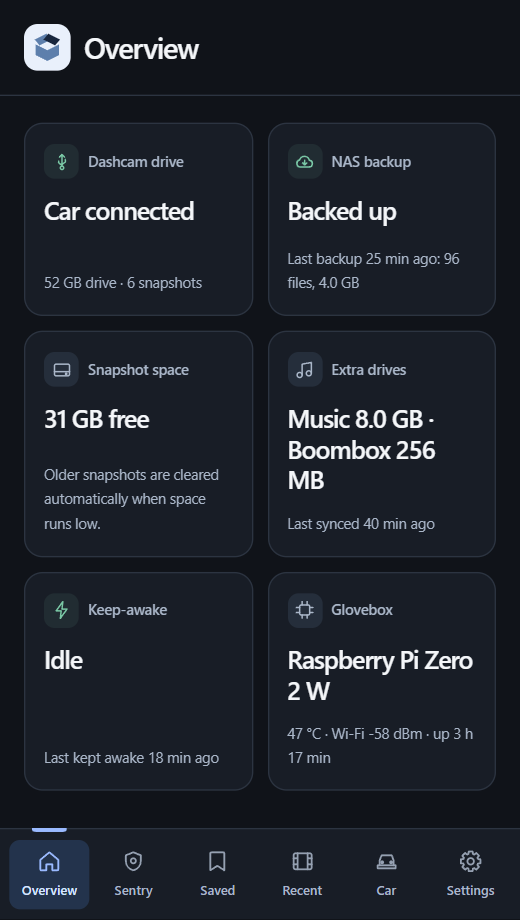
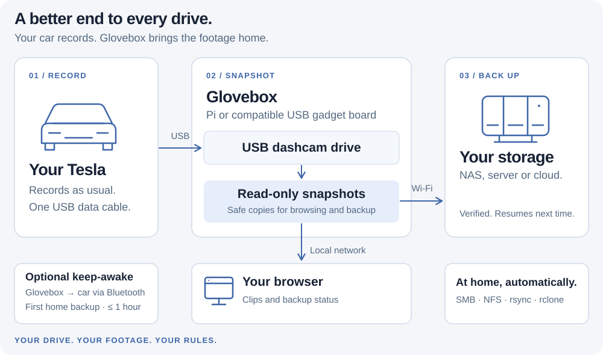

<p align="center">
  
</p>

<h1 align="center">Glovebox</h1>

<p align="center">
  <b>TeslaCam and Sentry Mode backup to your own NAS, from a Raspberry Pi Zero 2 W in your glovebox.</b><br>
  No cloud required. No subscription. Nothing leaves your home network unless you pick a cloud drive.
</p>

<p align="center">
  <a href="https://getglovebox.dev/">Website</a> ·
  <a href="https://getglovebox.dev/guides/quick-start/">Setup guide</a> ·
  <a href="https://getglovebox.dev/guides/compatibility/">Compatibility guide</a> ·
  <a href="https://getglovebox.dev/kit/">Want a ready-made kit? Register interest</a>
</p>

<p align="center">
  <a href="https://github.com/lubaxe/glovebox/actions/workflows/go.yml"></a>
  <a href="LICENSE"></a>
  
  
  <a href="https://buymeacoffee.com/lubaxe"></a>
</p>

<p align="center">
  
</p>

Glovebox plugs into your Tesla's USB port and becomes its dashcam drive. Your car records to it as usual. When you park at home, your Sentry Mode events, saved clips and (if you like) all your driving footage copy themselves over Wi-Fi to your NAS (Unraid, Synology, TrueNAS or any server, over SMB, NFS or rsync) or to cloud storage with rclone. Browse and play everything from any browser on your network, and keep the footage on the Pi encrypted with a key that's yours, not Tesla's.

<sub>Glovebox is free and open source. If it's useful to you, you can <a href="https://buymeacoffee.com/lubaxe">buy me a coffee</a> ☕</sub>

**Contents:** [Features](#features) · [What you need](#what-you-need) · [Getting started](#getting-started) · [Using Glovebox](#using-glovebox) · [Encryption](#encryption) · [How it works](#how-it-works) · [Is it safe?](#is-it-safe) · [FAQ](#faq) · [Development](#development)

## Features

- **Set up from your phone.** Flash the card and plug it in. Glovebox opens its own Wi-Fi network with a setup wizard for your home Wi-Fi, your backups, extra drives and your car. No files to edit.
- **Automatic backup when you get home.** Glovebox notices your NAS, copies what's new (Sentry first, then saved clips, newest first) and picks up where it left off if the car drives away mid-copy. SMB, NFS, rsync over SSH, or any of the 70-odd storage services rclone supports.
- **Keeps the car awake until the backup is done.** A sleeping Tesla cuts USB power. Glovebox pairs with your car over Bluetooth and nudges it to stay awake while it backs up, for at most an hour.
- **Doesn't back up your garage.** Footage the car records while parked at home isn't uploaded, so a long backup doesn't leave more to upload next time. (Parked outside? Turn it on in Settings.)
- **Never gets in the car's way.** Glovebox never touches the car's drive while the car is using it. It reads footage from instant copy-on-write snapshots, and presents the drive to the car about 16 seconds after power-on.
- **Bigger dashcam drive, more history.** The car gets nearly the whole card (52 GB on a 64 GB card), and snapshots keep clips the car has already overwritten.
- **Clean web app.** A synchronized six-camera player with the speed, gear, steering and Autopilot state the car recorded, Sentry and saved events with thumbnails and locations, your footage grouped into drives, and live status. Works on your phone.
- **Encrypted on the Pi, with your own key.** The drive only opens once Glovebox has seen your car over Bluetooth, and a recovery key that only you hold opens it anywhere. Unlike the car's own encryption, your clips still play in Glovebox and in the car. See [Encryption](#encryption).
- **Or keep Tesla's encryption.** If your car encrypts its clips, Glovebox backs them up as they are, and downloads a whole drive or event in one go for you to watch on dashcam.tesla.com.
- **Music, light shows and Boombox.** Optional extra drives for the car, filled from folders on your NAS and updated whenever you get home, while the dashcam keeps recording.
- **Looks after the car's drive.** Clears out events that are safely on your NAS so the car never runs out of room to save new ones. Nothing that isn't backed up is ever deleted.
- **Updates itself.** The Settings page says when there's a new release and installs it with one button, while the car keeps recording.

### Screenshots

<table>
  <tr>
    <td width="50%"><br><sub><b>Player:</b> six cameras in sync, with the speed, gear and Autopilot state the car recorded.</sub></td>
    <td width="50%"><br><sub><b>Sentry:</b> events with thumbnails, reasons and places. Encrypted ones are marked.</sub></td>
  </tr>
  <tr>
    <td><br><sub><b>Car:</b> pair once with a key card, step by step.</sub></td>
    <td><br><sub><b>Encrypted clips:</b> download a whole drive in one go for dashcam.tesla.com.</sub></td>
  </tr>
  <tr>
    <td><br><sub><b>Guided setup:</b> change just the part you need; the rest stays folded.</sub></td>
    <td align="center"><br><sub><b>First run:</b> set up from your phone, no files to edit.</sub></td>
  </tr>
  <tr>
    <td><br><sub><b>Backups:</b> SMB, NFS, rsync over SSH or rclone, with a connection test that says which step failed.</sub></td>
    <td align="center"><br><sub><b>On your phone</b>, from the garage.</sub></td>
  </tr>
</table>

<sub>Screenshots show real footage from a Model 3; the names, addresses and status are made up.</sub>

## What you need

| | |
|---|---|
| **A Raspberry Pi Zero 2 W** | Small enough for the glovebox, and it's the right kind of Pi: it can act as a USB drive. |
| **A microSD card** | A high-endurance card, 64 GB or more; 128–256 GB for more history on HW4 cars. For example SanDisk High Endurance or Samsung PRO Endurance. |
| **A USB cable** | Micro-USB to whatever your car's glovebox port is (USB-C on recent cars). It must carry data, not just power. It goes into the Pi's **USB** port, not **PWR**: one cable powers the Pi and carries the drive. |
| **Somewhere to back up to** | A NAS or server reachable from your garage over 2.4 GHz Wi-Fi, with an SMB share, an NFS export or SSH and rsync; or a cloud drive through rclone. A user and folder just for Glovebox is a good idea. |
| **A Tesla** | Tested on a 2026 Model 3 (HW4). Glovebox uses the standard TeslaCam drive, so other models should work too. |
| **A key card** (optional) | To pair keep-awake, once. |

## Getting started

1. **Flash the card.** Download `glovebox-<version>-image.zip` from the [latest release](https://github.com/lubaxe/glovebox/releases/latest) and write it with [Raspberry Pi Imager](https://www.raspberrypi.com/software/) (Choose OS → **Use custom**). When Imager offers to customise settings, choose **No**.
2. **Plug it in.** Put the card in the Pi and connect the Pi's **USB** port (not **PWR**) to the car's glovebox USB port. A phone charger or a computer works too, for setting up at your desk. The car sees its dashcam drive within about 20 seconds.
3. **Join Glovebox-XXXX.** After a couple of minutes the Pi offers its own Wi-Fi network, named **Glovebox-** and four characters. Join it with your phone; the setup page opens by itself (if it doesn't, open `http://192.168.66.1`).
4. **Follow the wizard:**
   - **Wi-Fi:** pick your home network and enter its password. The Pi Zero 2 W only does 2.4 GHz.
   - **Backups:** pick an SMB share, NFS export, rsync over SSH or rclone, fill in the details and press *Test the connection*. Glovebox checks it can reach the server, log in, and write, read back and delete a test file.
   - **Extra drives** (optional): music, a light show or Boombox sounds, copied from folders on your server.
   - **Your car:** enter your VIN, then pair keep-awake on the **Car** page: press *Send pairing request*, lay a key card on the phone charging pad and confirm on the car's screen.
   - **Finish.** The setup network turns off. From now on Glovebox is at `http://glovebox.local:8080` on your home network.

That's it. When you park at home, clips start copying to your NAS on their own, and the Overview page shows the progress.

The full guide, with troubleshooting, is in [docs/install.md](docs/install.md).

### Other boards, or an existing Raspberry Pi OS

The image is only for the Pi Zero 2 W, the board Glovebox is built and tested for. On anything else, or on a Pi already running Raspberry Pi OS Lite, use the installer:

```sh
curl -fsSL https://github.com/lubaxe/glovebox/releases/latest/download/install.sh | sudo bash
```

It first checks the board and stops if Glovebox can't work there (run it with `GLOVEBOX_CHECK_ONLY=1` to only check). The board needs a USB port that can act as a drive (Pi Zero, Zero W and Zero 2 W; Pi 4 and 5 on their USB-C port; some other boards), Wi-Fi, and ideally Bluetooth. A Pi 4 or 5 needs more power than many cars' USB ports give; Pi 1, 2 and 3B can't act as a USB drive at all. Once it's installed, open `http://<the board's name>.local:8080` and the same wizard starts.

## Using Glovebox

### Backups

When your NAS is reachable, Glovebox copies new clips on its own: Sentry events first, then saved clips, newest first, and all driving footage too if you turned that on in setup. Each file is verified before it's marked done, and if the car drives off mid-copy, it carries on next time.

It can back up to:

- **An SMB share**, with a built-in client (SMB 2.1 by default, as it's fastest on the Pi Zero 2 W).
- **An NFS export**, mounted only while backing up.
- **A folder on any server with rsync over SSH.** Glovebox makes its own key and shows it in setup.
- **Any rclone remote:** Google Drive, OneDrive, Dropbox, S3, Backblaze B2, SFTP, WebDAV and more. Set up the remote on a computer with `rclone config` and paste its `rclone.conf` in setup. Since a cloud drive answers from anywhere, rclone also needs a *home check address*, such as your router, that only answers at home.

Backups run at about 2.5–3.5 MB/s over the Pi Zero 2 W's Wi-Fi. Sentry and saved events (a few hundred MB each) take a minute or two. An hour of HW4 driving footage is 15–20 GB, which is why backing up all driving footage is optional.

While the first backup after you arrive home runs, Glovebox keeps the car awake over Bluetooth so it doesn't cut the power halfway, for at most an hour.

### Watching your footage

Open `http://glovebox.local:8080` from any browser on your home network, including your phone. Sentry and saved events are listed with thumbnails, reasons and places, and your driving footage is grouped into drives.

The player shows a large selected camera with a strip of the others, or all six in a grid, in sync, with seeking, speed, per-camera downloads and fullscreen, and a **Low data** mode that plays every camera at 2 frames a second for the Pi's Wi-Fi. Compatible recordings also show what the car recorded alongside the video: **speed, gear, steering wheel angle, accelerator and brake, turn signals and FSD / Autosteer / cruise state**, plus GPS, heading and acceleration in the details panel. These are values from the recording, not the car's current state. See [the viewer and telemetry notes](docs/viewer.md).

Clips the car encrypted itself are backed up as they are and shown with a lock. Download a whole drive or event in one go and open it at [dashcam.tesla.com](https://dashcam.tesla.com), signed in to your Tesla account.

### Music, light shows and Boombox

Turn on an extra drive by giving it a size in setup and naming a folder on your NAS to copy it from. Whenever the car gets home, after the backup, Glovebox brings each drive up to date in a copy of it. Only if something changed does it swap the copy in: the car sees that one drive unplugged and plugged back in, and keeps recording to the dashcam drive throughout. Light shows (an `.fseq` and an `.mp3` or `.wav` with the same name) end up in the drive's `LightShow` folder and Boombox sounds in its `Boombox` folder, where the car looks for them.

### Settings and updates

- **Guided setup**, on the **Settings** page, walks through the wizard again. What's set up already is folded into a summary; open just the part you want to change.
- **Settings** is split into **Backups**, **Extra drives**, **Security** and **Updates** tabs. **Save and restart** saves everything at once.
- **Updates:** while the web app is open, Glovebox checks for a new release and shows a notice when there is one. Install it from **Settings → Updates** with one button; the car keeps recording.
- **Moved house or changed your Wi-Fi?** Put an empty file named `glovebox-setup` on the card's boot partition and restart the Pi: the setup network comes back.

For setups without a phone, or to prepare many cards, every setting can also go in `glovebox.toml` on the boot partition before first boot; see [Setting up without the wizard](docs/install.md#setting-up-without-the-wizard). All settings and their defaults are in [deploy/glovebox.toml](deploy/glovebox.toml).

## Encryption

You choose who holds the key to your footage:

| | Nothing encrypted | **Glovebox encryption** | Tesla's encryption |
|---|---|---|---|
| Turn on | — | Settings → **Security** in Glovebox | Controls → Safety → Encrypt Dashcam Recordings in the car |
| Card on its own | Readable by anyone | Unreadable | Clips unreadable |
| Who can open it | Anyone | The Pi once it has seen your car, or your recovery key | Your car, and Tesla through your account |
| Watch in Glovebox | Yes | Yes | No: download for dashcam.tesla.com |
| Watch in the car | Yes | Yes | Yes |
| Copy on your NAS | Plain | Plain | Encrypted by Tesla |

### Turning on Glovebox encryption

1. Turn off **Encrypt Dashcam Recordings** in the car (Controls → Safety), so the car records clips Glovebox can play.
2. In Glovebox, open **Settings → Security** and choose **Create a key**. Your browser makes the key; only its public half goes to the Pi. Download the key file and keep it somewhere safe off the Pi, such as a password manager: it's the only way to open the footage if the Pi dies. Or use a key of your own from `age-keygen`.
3. Pair the car on the **Car** page and let a backup finish.
4. Press **Encrypt the drive** and type ERASE. This **erases the card**: the car's drive, snapshots and history, but not your NAS. Glovebox restarts, and the car gets a fresh, empty drive a minute or two later.

From then on, every time the car wakes Glovebox, it checks for your car over Bluetooth before giving the car its drive. That takes about two seconds. The drive then stays open until the car cuts the power. If the car can't be reached, the web app shows the drive as locked, and **Unlock with your key** opens it. The card also holds a README explaining how to open it on a Linux PC with your key.

### What it protects against

The card on its own can't be read. Someone who takes the whole Pi can't browse the footage without your car nearby. But the Pi Zero 2 W has no secure chip, so its own key is stored on the Pi: someone who takes the Pi and knows what they're doing can still decrypt it. The copy on your NAS isn't encrypted. While the drive is open, anyone on your network can watch it in the web app, as without encryption. Details are in [Encrypted on the Pi](docs/how-it-works.md#encrypted-on-the-pi).

## How it works

<picture>
  <source media="(prefers-color-scheme: dark)" srcset="docs/images/how-it-works-dark.svg">
  
</picture>

1. **The car records** to Glovebox exactly as it would to a USB stick.
2. **Glovebox snapshots the drive** every hour, before each backup, and whenever space runs low. Snapshots are instant and only use space for what the car changes afterwards. Everything Glovebox reads comes from a snapshot, so it never touches files the car might be writing.
3. **At home, it backs up.** When your NAS is reachable, Glovebox copies new clips over SMB, NFS, rsync or rclone, verifying each file before marking it done. If the car drives off, it carries on next time.
4. **The car stays awake** for that first backup after arriving home, at most an hour, so it doesn't cut the power halfway. After that it's free to sleep.

The details, from partitions to power cuts, are in [docs/how-it-works.md](docs/how-it-works.md).

### Lean by design

The Glovebox image is Raspberry Pi OS cut down to what a dashcam drive needs, so it downloads faster, boots faster and leaves more of the card for footage.

- **Less than half the size** of Raspberry Pi OS Lite, to download and on the card, with less than half the packages.
- **Nearly the whole card for footage:** on a 64 GB card the car gets a dashcam drive of about 52 GB, plus a few GB for snapshots.
- **The car sees its drive about 16 seconds after power-on**, and the Pi is fully booted soon after.
- **About a third of the Pi Zero 2 W's memory** in use.

How: the image is built from Raspberry Pi's own build system, keeping only its base stages and leaving out the desktop, compilers, kernel headers, the Pi 5 kernel, cloud-init, swap, man pages and translations. Glovebox starts before the network, presents the car's drive within about a second, and only then gets on with snapshots and backups. Logs are kept in memory to save writes to the card, with a small copy on the storage partition that survives power cuts.

## Is it safe?

- **For your car:** keeping the car awake needs a Bluetooth key with Tesla's **Driver** role: the car only lets a Driver key close the charge port, which is what keeps it awake (we tested the more limited roles; they can't). Glovebox only ever sends wake, close-the-charge-port and charging-current commands, and the key doesn't open the doors as you walk up the way a phone does. But someone who took the Pi could use the key to unlock and drive the car, so **turn on PIN to Drive** (Controls → Safety), and remove the key under Controls → Locks → Keys if the Pi is ever lost.
- **If the Pi is stolen:** with [Glovebox encryption](#encryption) on, the card can't be read on its own, and the Pi won't open the footage away from your car. Without it, everything on the card is readable.
- **For your footage:** the car's drive is never written to while the car can see it. Glovebox only ever deletes events from the car's drive once they're on your NAS at full size, and only at startup, before the car is connected.
- **For your privacy:** with a NAS, footage goes from the car to your NAS and never leaves your home network. Only if you pick a cloud drive (through rclone) does it go there, and nowhere else. Glovebox itself never contacts any other server; the Pi only sets its clock from a public time server.
- **The setup network** is open, so anyone nearby could join it while it's on. It's only on until Glovebox is set up, before there's any footage, and turns off for good once you finish the wizard (at most 30 minutes after the Pi first joins your Wi-Fi).
- **On your network:** the web app has no login. Anyone on your home network can view clips and change settings, so keep the Pi on a network you trust.

## FAQ

**I don't see the Glovebox-XXXX network.**
Give the Pi two minutes after plugging it in: it waits that long for a Wi-Fi network it already knows. The network only appears until Glovebox is set up. To bring it back later, put an empty file named `glovebox-setup` on the boot partition and restart the Pi.

**Do I have to edit any files?**
No. Everything is set up in the wizard on your phone. `glovebox.toml` on the boot partition is only there for setting up without a phone; see [Setting up without the wizard](docs/install.md#setting-up-without-the-wizard).

**Will it drain my battery?**
Glovebox keeps the car awake only for the first backup after you arrive home, at most an hour, then lets it sleep for at least six hours. Clips the car records while parked are backed up whenever the car is awake anyway, but never keep it awake.

**What happens when the card fills up?**
The car's drive has a fixed size, and the car manages it like any USB drive. Glovebox clears out backed-up events so the car keeps room for new ones, and drops its oldest snapshots when it needs space.

**My car encrypts its recordings. Does Glovebox still work?**
Yes. Glovebox backs them up as they are and shows them with a lock; watch them at [dashcam.tesla.com](https://dashcam.tesla.com). Or turn off the car's encryption and let Glovebox encrypt the card instead, with a key that's yours; see [Encryption](#encryption).

**I lost my key file. What now?**
While the drive is unlocked, make a new key under Settings → Security and replace the old one: Glovebox re-seals the drive to it. If the drive is locked and the car can't be reached, the footage on the card can't be recovered without the key; anything already backed up is still on your NAS.

**Can I turn Glovebox encryption off again?**
Not yet from the web app. Reflashing the card gives a fresh, unencrypted Glovebox; your backups on the NAS aren't affected.

**Can I use a different Raspberry Pi, or another board?**
Possibly, with the installer instead of the image; see [Other boards](#other-boards-or-an-existing-raspberry-pi-os).

## Development

Glovebox is a single Go service (`cmd/glovebox`) on a minimal 64-bit Raspberry Pi OS image. [docs/architecture.md](docs/architecture.md) describes the design, and [docs/how-it-works.md](docs/how-it-works.md) the behaviour and the API.

- `go test ./...` runs anywhere; the hardware parts (loop devices, mounts, the USB gadget, NetworkManager, Bluetooth, cryptsetup) sit behind small interfaces with fakes. `internal/crypt` and `internal/provision` also have integration tests that run on a Pi as root (`go test -c -tags integration`).
- `node --test scripts/web-ui.test.mjs scripts/player.test.mjs` tests the web app: update notifications, offline recovery, request throttling and recorded telemetry selection.
- `go run ./tools/uidemo` serves the web app with generated sample footage, for working on the UI without a Pi (needs ffmpeg). `-firstrun` starts it as a Pi on its setup network, `-extras` adds extra drives.
- `scripts/deploy.ps1 -Target user@host` cross-compiles for linux/arm64 and installs the service on a Pi over SSH.

### Building the image

The image is Raspberry Pi OS (Debian 13 "trixie", 64-bit) cut down to what Glovebox needs, with Glovebox and Tesla's `tesla-control` compiled in. See [pi-gen-sources/Readme.md](pi-gen-sources/Readme.md).

- **Releases:** bump `VERSION` and push to the `release` branch. CI builds the image, the programs and `install.sh`, measures the image, and publishes release `v<VERSION>` with checksums.
- **Test builds:** run **Build image** by hand in GitHub Actions for a pre-release.
- **Locally:** run `pi-gen-sources/build-image.sh` on Debian/Ubuntu or WSL2.

## Feedback

Bug reports and ideas are welcome in [Issues](https://github.com/lubaxe/glovebox/issues).

## Credits

Glovebox was inspired by, and started from, [teslausb](https://github.com/marcone/teslausb). Thanks to its authors and contributors. Keep-awake uses Tesla's open-source [vehicle-command](https://github.com/teslamotors/vehicle-command) tools. Their licenses, and those of the libraries Glovebox is built with, are in [THIRD-PARTY-NOTICES.md](THIRD-PARTY-NOTICES.md).

## License

Copyright © 2026 lubaxe.

Glovebox is free software, licensed under the [GNU General Public License v3.0](LICENSE): you can use it, change it and share it, and if you distribute it, changed or not, you must do so under the same license, with its source and this copyright notice. For other licensing, for example to build Glovebox into a commercial product without the GPL's terms, [get in touch](https://github.com/lubaxe/glovebox/issues).

Glovebox is not affiliated with or endorsed by Tesla, Inc. "Tesla" and "TeslaCam" are trademarks of Tesla, Inc., used here only to say what Glovebox works with.
