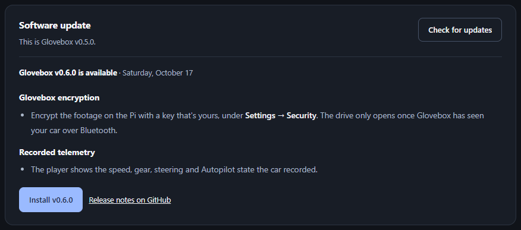

# Installing Glovebox

There are two ways to get Glovebox onto a Pi:

- **[Flash the Glovebox image](#flash-the-glovebox-image)** onto a new card, for a Pi Zero 2 W. This is the easiest, and the image is cut down to exactly what Glovebox needs, so it boots faster and leaves more room for footage.
- **[Install on Raspberry Pi OS or another board](#install-on-raspberry-pi-os-or-another-board)** you've already set up, without reflashing. The image is only for the Pi Zero 2 W; the installer checks other boards and installs where Glovebox can work.

Either way, you then [set it up from your phone](#set-up-from-your-phone) in a wizard. No files to edit.

## What you need

- A **Raspberry Pi Zero 2 W**.
- A **microSD card**, 64 GB or larger, ideally a high-endurance one (SanDisk High Endurance, Samsung PRO Endurance, ...). Dashcams write constantly.
- A **USB data cable** from the Pi's **USB** port (the one in the middle, not **PWR**) to your car's glovebox USB port: micro-USB to USB-C on recent Teslas. Charge-only cables won't work.
- **Somewhere to back up to**, reachable over 2.4 GHz Wi-Fi from where you park: a NAS or computer with an SMB share or NFS export, a server you can reach with SSH and rsync, or cloud storage through rclone.
- A **phone** (or laptop) with Wi-Fi, for setting up.

## Flash the Glovebox image

1. Download `glovebox-<version>-image.zip` from the [latest release](https://github.com/lubaxe/glovebox/releases/latest).
2. Open [Raspberry Pi Imager](https://www.raspberrypi.com/software/), pick **Raspberry Pi Zero 2 W**, then **Choose OS → Use custom** and select the zip. Pick your card and write it. When Imager offers to customise settings, choose **No**: Glovebox sets up Wi-Fi itself.
3. Put the card in the Pi and plug the Pi into the car, or into a phone charger or computer to set it up at your desk.

On the first boot Glovebox makes room for the car's drive and presents it; the first boot takes a little longer, and after that the car sees its drive about 16 seconds after power-on. Then [set it up from your phone](#set-up-from-your-phone).

## Install on Raspberry Pi OS or another board

The Glovebox image is only for the Pi Zero 2 W. Everywhere else, the installer puts Glovebox on a system you've already set up: Raspberry Pi OS Lite (32- or 64-bit, trixie or newer) on another Pi, or a Debian-based system such as Armbian on another board. It should already be on Wi-Fi with SSH working; a fresh Raspberry Pi OS Lite from Raspberry Pi Imager, with Wi-Fi and SSH set in its settings, is perfect.

Log in and run:

```sh
curl -fsSL https://github.com/lubaxe/glovebox/releases/latest/download/install.sh | sudo bash
```

First the installer checks the board, and stops if Glovebox can't work there:

| | |
|---|---|
| **USB drive** | The board needs a USB port that can act as a drive: the data port of a Pi Zero, Zero W or Zero 2 W, the USB-C port of a Pi 4, 5, 400, 500 or CM4/CM5, or a USB device controller on other boards. Pi 1, 2 and 3B can't. |
| **System** | A Debian-based Linux with systemd and a kernel 5.10 or newer with XFS, exFAT and the USB gadget modules, and about 500 MB free. |
| **Warnings only** | No Bluetooth (no keep-awake), no NetworkManager (no setup network; set up Wi-Fi in the system), the original Zero W (slower), a Pi 4 or 5 (needs about 3 A, more than many cars' USB ports give), and any board Glovebox isn't tested on. |

To only see the checks, without installing anything:

```sh
curl -fsSL https://github.com/lubaxe/glovebox/releases/latest/download/install.sh | sudo GLOVEBOX_CHECK_ONLY=1 bash
```

Then it:

- installs Glovebox, Tesla's `tesla-control`, and the tools they need (XFS, exFAT and FAT tools; rsync, rclone and NFS for backups; dnsmasq for the setup network and Avahi for `.local` names)
- on a Raspberry Pi, turns on USB device mode in `config.txt` (`dtoverlay=dwc2`, with `dr_mode=peripheral` on a Pi 4 or 5). On other boards, the port you plug into the car has to be in peripheral or OTG mode in the board's device tree; see its documentation.
- creates the space for the car's drive and Glovebox's snapshots. The system usually has the whole card, so this is a large file, `/var/lib/glovebox/backingfiles.xfs`, mounted at `/backingfiles`. It takes all the free space except 3 GB; set `GLOVEBOX_BACKINGFILES_SIZE=48G` (for example) before `sudo bash` to choose.
- starts Glovebox, or tells you to reboot if USB device mode needs it

Your existing user, Wi-Fi, SSH settings and anything else on the system stay as they are. Since it's already on Wi-Fi, there's no setup network: open `http://<the board's name>.local:8080` (e.g. `http://raspberrypi.local:8080`) and the wizard starts.

## Set up from your phone

### Join the setup network

If the Pi isn't on Wi-Fi yet, it offers its own network about two minutes after it starts, named **Glovebox-** and four characters (the end of the Pi's Wi-Fi address). It's open, and only there until Glovebox is set up.

Join it. Most phones then show a sign-in page, which is Glovebox's setup. If yours doesn't, open `http://192.168.66.1` in the browser.

### The wizard

<p align="center"></p>

1. **Wi-Fi.** Pick your home network (*Scan* looks again), enter its password, and pick your country, which sets the Wi-Fi channels allowed there. The Pi Zero 2 W only does 2.4 GHz. Your phone may drop off the setup network for a moment while the Pi connects; the page picks up where it was. Once connected, the page shows the Pi's address on your home network, e.g. `http://glovebox.local:8080`. You can carry on over the setup network or switch your phone back to your home Wi-Fi and open that address.
2. **Backups.** Pick where clips go and fill in the details:
   - **SMB share:** the NAS's address, the share, an optional folder, and a user and password.
   - **NFS export:** the server's address and the exported folder's path. It must allow writes from the Pi.
   - **rsync over SSH:** the server, user and folder. Press **Create Glovebox's SSH key** and add the line it shows to `~/.ssh/authorized_keys` of that user on the server.
   - **rclone:** set up the remote on a computer with `rclone config` (it signs in to cloud services in a browser), then paste the contents of its `rclone.conf` (`rclone config file` shows where it is). Pick the remote and a folder, and enter a **home check address**: something only reachable at home, such as your router (e.g. `192.168.1.1:80`), so Glovebox knows when the car is home.

   Press **Test the connection**: Glovebox reaches the server, logs in, writes a small test file, reads it back and deletes it, and says which step failed if one does. Tick **Also back up all driving footage** if you want Recent clips too (15–20 GB per hour of driving).

   

3. **Extra drives** (optional). Give the music, light show or Boombox drive a size and name the folder on your server to copy it from. The dashcam drive keeps the rest of the space.
4. **Save.** Glovebox restarts with the new settings; the dashcam drive stays connected.
5. **Your car.** Enter your VIN (in the car under Controls → Software, or in the Tesla app). Then, in the car with a key card, open the **Car** page: press **Send pairing request**, lay the key card on the phone charging pad behind the cupholders, and confirm on the car's screen. Press **Check pairing** to make sure. This can wait until later.
6. **Finish setup.** The setup network turns off.

Plug the Pi into the car if it isn't already. The car's dashcam icon should show it's recording within about 20 seconds. When you park at home, clips start copying on their own; the Overview page shows the progress.

## Changing settings later

- **Settings → Guided setup** runs the wizard again. What's set up already is folded into a summary with a button to change just that part.
- **Settings** itself shows all backup and drive settings on one page.
- **Moved house or changed your Wi-Fi?** Put an empty file named `glovebox-setup` on the card's boot partition (the drive called **bootfs** on a computer) and restart the Pi. The setup network comes back until you've finished the wizard again.


The settings are stored in `/etc/glovebox/glovebox.toml` on the Pi, with passwords in root-only files next to it.

## Updating

The bottom of the **Settings** page shows the version the Pi runs and checks GitHub for a newer release when you open it (at most every six hours). After that, the sidebar also says when one is available. **Install** downloads it, checks the files against the release's `SHA256SUMS`, makes sure the new version runs on this board, puts it in place and restarts Glovebox. That takes a minute or two on a Pi Zero 2 W. The car's drive stays connected the whole time, so the car keeps recording. If the car is paired for keep-awake, Glovebox keeps it awake until the update is done, so the car going to sleep can't cut the Pi's power partway. The page reloads with the new version.



This works on any board where Glovebox came from the image or `install.sh`: it fetches the 64-bit or 32-bit ARM build to match the board. It updates Glovebox itself, `tesla-control` and the service. It doesn't install system packages a newer release may need. When a release needs new packages, its notes say so: run its `install.sh` again (your settings and recordings are kept) or flash the new image.

The previous version is kept as `/usr/local/bin/glovebox.old`. To go back to it:

```sh
sudo mv /usr/local/bin/glovebox.old /usr/local/bin/glovebox && sudo systemctl restart glovebox
```

## Setting up without the wizard

To set up a card without a phone, or prepare several the same way, fill in `glovebox.toml` on the card's boot partition before the first boot. Take the card out after flashing and put it back in: a drive called **bootfs** appears with `glovebox.toml` on it. Every setting is explained in the file; delete the `# ` in front of the ones you use. The full list, with defaults, is in [deploy/glovebox.toml](../deploy/glovebox.toml). For rclone, put your `rclone.conf` next to it.

At boot, Glovebox applies the file: Wi-Fi becomes a NetworkManager connection, passwords move to root-only files, the rest goes to `/etc/glovebox/glovebox.toml`, and the file on the boot partition is replaced by `glovebox-status.txt` saying what was done (or what was wrong with it). To change settings this way later, put a new `glovebox.toml` there, with just the settings to change, and restart the Pi. On Raspberry Pi OS the file is `/boot/firmware/glovebox.toml`.

## Troubleshooting

| Problem | What to check |
|---|---|
| The car doesn't see the drive | The cable must go into the Pi's **USB** port, not **PWR**, and must carry data. Use the glovebox port: the console ports in some cars only charge. |
| No Glovebox-XXXX network | Wait two minutes after power-on. It only appears while the Pi has never joined Wi-Fi, or until the wizard is finished; to bring it back, put an empty `glovebox-setup` file on the boot partition and restart. |
| The phone shows no sign-in page | Open `http://192.168.66.1` while on the setup network. Some phones switch back to mobile data on a network without internet; turn mobile data off for a moment. |
| The Pi doesn't join Wi-Fi | The Pi Zero 2 W only does 2.4 GHz. Check the password and country in the wizard; the error says what NetworkManager reported. |
| Can't open glovebox.local | Some networks and older Android versions don't resolve `.local` names. Use the address the wizard showed, or find `glovebox` in your router's device list. |
| Backups don't start | Press **Test the connection** on the Settings page. The NAS must be reachable from the garage (port 445 for SMB, 2049 for NFS, 22 for SSH), or for rclone the home check address. The Overview page and `/backingfiles/glovebox.log` show what happened. |
| Pairing shows nothing on the car's screen | Nothing appears until you lay the key card on the phone charging pad. The request expires after about 30 seconds, so send it again just before. |
| Clips show a lock | Your car encrypts its recordings. See [Encrypted clips](how-it-works.md#encrypted-clips). |
| "The drive is locked" | The drive is encrypted and Glovebox hasn't reached the car over Bluetooth yet; the page shows why. Check that the car is awake and the key is still listed under Controls → Locks → Keys, or unlock with your key. See [Encrypted on the Pi](how-it-works.md#encrypted-on-the-pi). |

## Uninstalling (after install.sh)

```sh
sudo systemctl disable --now glovebox
sudo umount /backingfiles
sudo rm /etc/systemd/system/glovebox.service /usr/local/bin/glovebox /usr/local/bin/tesla-control
sudo rm -r /etc/glovebox /var/lib/glovebox /backingfiles /usr/share/doc/glovebox
sudo rm -f /etc/NetworkManager/system-connections/glovebox-*.nmconnection /etc/NetworkManager/dnsmasq-shared.d/glovebox-setup.conf
```

Then remove the `/backingfiles` line from `/etc/fstab` and the Glovebox lines at the end of `/boot/firmware/config.txt`. Removing `/var/lib/glovebox` deletes the car's drive and every snapshot on it. If you joined Wi-Fi through Glovebox's wizard, the last command removes that connection too; set Wi-Fi up again with `nmtui` first if you still need it.
